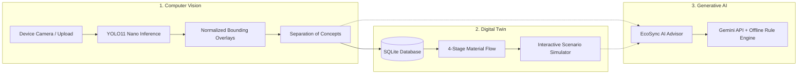

# EcoSync — Smart Waste Management Digital Twin
### Enterprise Circular Intelligence & Household Resource Recovery Platform

> **Municipal Smart Waste Management Digital Twin**  
> *"Empowering households with computer vision, operational simulation, and generative AI to segregate responsibly and build zero-waste communities."*

---

## 🌟 Executive Overview

**EcoSync** transforms complex municipal waste management into an intuitive, actionable, and household-friendly digital companion. Designed for everyday citizens and connected to municipal operations, EcoSync addresses the five core questions every citizen faces:

1. **What is this item?**
2. **What type of waste does it belong to?**
3. **How should I handle and prepare it safely?**
4. **How can I reduce, reuse, or recycle it?**
5. **How do my everyday habits improve my local community?**

Simultaneously, EcoSync provides municipal stakeholders, environmental officers, and evaluators with a **credible, data-connected Digital Twin** and an **interactive scenario simulator** to project how community participation affects collection efficiency, landfill diversion, and environmental recovery.

---

## 🏛️ The Three Pillars of Technology

EcoSync directly implements all three mandatory problem statement pillars:



### 1. Computer Vision (Real Multi-Object Inference)
- **Supplied Model**: Ultralytics YOLO11 Nano (`models/yolo11n.pt`).
- **Honest AI Engineering**: No fabricated green boxes, no simulated detections, and no hardcoded confidence values. Real bounding boxes and actual confidence scores.
- **Aspect-Ratio Invariant Coordinate Engine**: Bounding boxes are stored and calculated in normalized space ($[0.0, 1.0]$), guaranteeing pixel-perfect alignment across mobile, tablet, and desktop viewports without offset errors.
- **Strict Separation of Five Concepts**:
  1. *Visual Detection*: What the camera visually identifies (e.g. `bottle`).
  2. *Object Identity*: Common household item name (e.g. `Beverage Container (Plastic / Glass)`).
  3. *Material Substrate*: Estimated physical composition (e.g. `PET Plastic / Soda-Lime Glass`).
  4. *Waste Category*: The operational waste stream (e.g. `Recyclable materials`).
  5. *Disposal Recommendation*: Specific preparation and route.
- **Camera Viewfinder**: Live camera feed with **Enable Camera**, **Capture Frame**, **Pause/Resume**, and **Stop** controls, with graceful error handling for permission denials or missing video devices.

### 2. Digital Twin & Scenario Simulator
- **4-Stage Material Flow Pipeline**: Models the journey of municipal waste:
  $$\text{Household Generation} \longrightarrow \text{Neighborhood Collection} \longrightarrow \text{Optical Sorting (MRF-01)} \longrightarrow \text{Secondary Recovery / Landfill}$$
- **Real Database Connectivity**: Real-time aggregation of verified household scans (`household_scans`) and municipal collection batches (`waste_batches`).
- **Before vs After Scenario Comparison Engine**: Directly compares city baseline performance (35% segregation) against simulated policy improvements:
  - Landfill Diversion Rate (%) Before vs After with net delta (+X%)
  - Daily Landfilled Waste (Tons/day) reduction (-Y TPD)
  - Avoided Daily GHG Emissions (+Z MT CO₂e/day)
  - Contamination Rejection Loss (-C TPD)
- **Non-Destructive Scenario Simulator**: Planners and evaluators can model policy adjustments without altering historical records:
  - **Daily Waste Volume** (50 - 500 TPD)
  - **Citizen Segregation Compliance** (10% - 95%)
  - **Collection Capacity** (100 - 400 TPD)
  - **Processing Capacity** (100 - 350 TPD)
- **One-Click Municipal Presets**:
  - `Baseline City (35% Segregation)`: Status-quo unoptimized performance.
  - `EcoSync Adoption (85% Segregation)`: High household civic engagement.
  - `High Volume Stress (380 TPD)`: Evaluates fleet and optical sorter bottlenecks.

### 3. Generative AI & Circular Economy Advisor
- **Hybrid Intelligence**: Integrated with the **Google Gemini API** (`gemini-2.5-flash`) with an **offline deterministic rules engine fallback** covering all standard household edge cases.
- **Context Injection**: Citizens can click *"Ask AI Advisor"* from any scanned object or guide entry to auto-populate technical waste queries.
- **Household Edge Cases Solved**:
  - Greasy pizza boxes (compost bottom / recycle clean lid).
  - Lithium-ion vs. alkaline batteries (drop-off hazard vs. solid waste).
  - Medicine blister packs and expired drugs.
  - Used cooking grease & motor oil (never pour down drain!).
  - Broken ceramic tiles vs. container glass.

---

## 🔬 Must-Have Demo Mode (Executive & Evaluator Ready)

EcoSync features a dedicated, executive-ready **Demo Mode** requiring **zero external dependencies, zero API keys, and zero camera setup**:
- **One-Click Launch**: Click **"Demo Data: ON"** in the sticky header or **"Explore Demo Data (60s Tour)"** on the homepage.
- **60-Second Guided Tour Modal**: Direct 5-step interactive walkthrough guiding evaluators through the Scanner, 8-Category Guide, Digital Twin Simulator, Impact Dashboard, and AI Advisor.
- **Pre-Populated Fictional Data**: 10 realistic demonstration records distributed across the last 5 days covering all 8 waste categories with timestamps and EPA WARM lifecycle metrics.
- **Explicit Labeling**: Every view and table row using seeded records displays a visible `[DEMO DATA]` tag, strictly separated from verified user scans (`is_demo = 0`).
- **One-Click Reset**: Click **"Reset Demo Data"** anytime to restore the clean baseline demonstration dataset without affecting real user records.

---

## 📘 Responsible Citizen Guide: The 8-Point Framework

Every scan and guide lookup provides an 8-point actionable breakdown across all 8 canonical waste categories:

| Point | Citizen Question | Example (Plastic Beverage Bottle) |
| :--- | :--- | :--- |
| **1. What is it?** | Plain-language identification | Clean PET beverage bottle (#1 plastic). |
| **2. What should I do now?** | Immediate action step | Empty remaining liquid completely and rinse lightly. |
| **3. Which bin should I use?** | Official bin stream | **Blue Bin** (Dry Recyclables). |
| **4. How should I prepare it?** | Physical preparation | Crush or flatten to save collection volume; replace plastic cap. |
| **5. What should I avoid?** | Common citizen mistake | Do not leave liquids inside; never mix chemical bottles. |
| **6. Where should it go?** | End destination | Curbside dry recycling pickup or bottle deposit kiosk. |
| **7. Why does this matter?** | Community / climate benefit | Saves over 60% virgin crude oil; recyclable 7-10 times. |
| **8. Good-citizen action** | Practical habit | Carry a reusable bottle to avoid single-use packaging. |

### The 8 Canonical Waste Categories Covered:
1. **Municipal solid waste**: Multi-layer snack wrappers, disposable cups, composite packaging.
2. **Organic and biodegradable waste**: Kitchen scraps, fruit/vegetable peels, garden yard clippings.
3. **Recyclable materials**: Cardboard boxes, clean paper, PET/HDPE plastics, glass jars, aluminum & tin cans.
4. **Hazardous waste**: Household alkaline/lithium batteries, CFL mercury bulbs, solvent & paint cans.
5. **Electronic waste**: Obsolete smartphones, computer mice/keyboards, charging cords & power bricks.
6. **Liquid waste**: Cooled cooking oils & grease (sealed jar), used motor engine oil.
7. **Construction and demolition waste**: Broken ceramic tiles, masonry mortar, gypsum plasterboard offcuts.
8. **Biomedical and healthcare waste**: Expired medications (blister packs), diabetic lancets & syringe sharps.

---

## 📊 My Impact & Activity History + CSV Export

- **Honest Environmental Accounting**: EcoSync explicitly distinguishes between:
  - **Self-Reported Citizen Logs**: Estimated diversion habits recorded by household users.
  - **Municipal Facility Telemetry**: Verified physical receipts logged at material recovery centers.
- **Relatable Human Equivalencies**: Avoided car kilometers driven, smartphone battery charges conserved, and 9W LED illumination hours saved.
- **Searchable Activity History**: Filter by keyword search, category, or record type (Verified Citizen vs Demo Data).
- **One-Click CSV Export**: Instant download of RFC-4180 compliant CSV (`/api/history/export`) with timestamped item records, lifecycle carbon offsets, and energy savings.

---

## 📁 Project Directory Structure

```text
ecosync/
├── app.py                      # Flask entrypoint & application factory
├── config.py                   # Central configuration & upload parameters
├── requirements.txt            # Python dependencies (Flask, Ultralytics, PyTorch)
├── .env.example                # Environment variables template (GEMINI_API_KEY)
├── README.md                   # Complete architectural documentation & platform guide
├── database/
│   ├── db.py                   # SQLite connection manager, schema runner, demo seeder & reset
│   ├── schema.sql              # Table definitions (household_scans with is_demo, waste_batches, etc.)
│   └── ecosync.db              # SQLite persistent database
├── models/
│   ├── yolo11n.pt              # Official pretrained YOLO11 Nano weights
│   └── README.md               # Model specifications and class taxonomy
├── routes/
│   ├── demo.py                 # /api/demo/status, /api/demo/reset, /api/demo/walkthrough
│   ├── scanner.py              # /api/detect, /api/classifications/confirm
│   ├── waste_guide.py          # /api/waste-guide, /api/waste-guide/item/<id>
│   ├── digital_twin.py         # /api/digital-twin, /api/simulation/scenario
│   ├── analytics.py            # /api/household/impact, /api/history, /api/history/export
│   └── advisor.py              # /api/advisor/query, /api/advisor/insights
├── services/
│   ├── model_loader.py         # Singleton YOLO11 loader & class verification
│   ├── waste_detector.py       # Real bounding box normalization & concept separation
│   ├── waste_guide_service.py  # Comprehensive 8 categories & 8-point guidance matrix
│   ├── simulation_engine.py    # Digital Twin flow network & Before/After scenario projector
│   ├── impact_calculator.py    # EPA WARM v15 conversion indices
│   └── advisory_engine.py      # Dual Gemini API + deterministic offline rules
├── static/
│   ├── css/
│   │   └── main.css            # Botanical green design system & responsive layout
│   ├── js/
│   │   ├── scanner.js          # Camera feed, canvas bounding box overlay, confirm flow
│   │   ├── waste_guide.js      # Search, 8-category cards, accordion guidance
│   │   ├── digital_twin.js     # Flow topology canvas & Before/After comparison
│   │   ├── impact.js           # Impact KPI counters, history filter & export
│   │   ├── advisor.js          # AI query console with prompt suggestions
│   │   └── main.js             # 5-view router, Demo Mode banner & modal tour
│   └── images/
│       └── samples/            # Test sample images (bottles, cans, mixed, boxes)
├── templates/
│   └── index.html              # Clean single-page household responsive interface
├── tests/
│   ├── test_demo_and_export.py # Demo endpoints, CSV export & comparison tests
│   ├── test_analytics.py       # Impact KPI & telemetry tests
│   ├── test_household_and_guide.py # Waste guide, categories & scenario tests
│   ├── test_scanner.py         # YOLO inference, coordinates & confirmation tests
│   └── test_workflows.py       # Full end-to-end integration workflows
└── uploads/                    # Temporary uploaded image staging
```

---

## ⚡ Quick Start Guide (Windows & Cross-Platform)

### 1. Prerequisites
- Python 3.10+ (Tested on Python 3.12)
- Git

### 2. Installation & Setup
```bash
# Navigate to the repository
cd ecosync

# Create and activate a virtual environment
python -m venv venv

# On Windows (PowerShell):
.\venv\Scripts\activate

# On macOS/Linux:
source venv/bin/activate

# Install dependencies
pip install -r requirements.txt
```

### 3. Optional: Configure Gemini API Key
To enable cloud-powered generative explanations, create a `.env` file:
```env
GEMINI_API_KEY="your_actual_gemini_api_key_here"
```
*(If omitted, EcoSync automatically operates seamlessly with its offline deterministic circular economy rules engine).*

### 4. Launch the Platform
```bash
python app.py
```
Open your web browser and navigate to:
**`http://127.0.0.1:5000`**

### 5. Run the Automated Tests
```bash
pytest
```
All **24 automated tests** will execute and validate the Computer Vision inference, Demo Mode API, CSV Export, Waste Guide categories, Scenario Simulator, Database persistence, and Analytics calculations.

## ☁️ Deploy on Render

This project is a Flask application, so GitHub Pages cannot run its backend or render its templates. To deploy it on Render:

1. Push the repository, including `render.yaml`, to GitHub.
2. In Render, choose **New + → Blueprint** and connect this GitHub repository.
3. Review the Blueprint and create the `ecosync` service. Add `GEMINI_API_KEY` if you want cloud-powered AI responses; it can be left unset to use the offline advisor.

The Blueprint uses Gunicorn, checks `/api/health`, and mounts a persistent disk for the SQLite database and uploaded images. The persistent disk requires a paid Render web service.

---

## 🎯 60-Second Executive Platform Tour
 
| Step | View | What to Test & Observe |
| :--- | :--- | :--- |
| **1. Household Hub** | **Home** | • Observe live community stats populated with clearly labeled `[DEMO DATA SEEDED]` tags.<br>• Click any quick item card (e.g. *PET Plastic Bottle* or *Batteries*) for instant 5-second handling rules. |
| **2. Smart Scanner** | **Scan Waste** | • Click guided sample **"Beverage Cans"** or **"Water Bottles"** (or use your live webcam).<br>• Observe genuine YOLO11n bounding boxes, actual confidence scores, and the 8-point citizen guidance.<br>• Click **"Confirm & Log to My Impact"** to witness persistent database storage. |
| **3. Waste Guide** | **Waste Guide** | • Search *"battery"*, *"cooking oil"*, or *"pizza box"*.<br>• Inspect the prominent safety warnings for hazardous/sharps and specific bin colors across all 8 categories. |
| **4. Digital Twin** | **Digital Twin** | • Move the **Source Segregation** slider to **85%**.<br>• Watch the **Before vs After Scenario Comparison Table** instantly calculate net landfill savings (+62.5 TPD diverted) and avoided CO₂e (+78.1 MT/day). |
| **5. Impact & Export** | **My Impact** | • Review EPA WARM carbon and energy savings.<br>• Filter activity history by category or record type.<br>• Click **"📥 Export Verified CSV"** to download the complete audit trail. |
| **6. AI Advisor** | **AI Advisor** | • Click prompt chips (e.g. *"How do I dispose of old phone batteries?"*).<br>• Observe tailored, safety-grounded advisory answers with automatic offline fallback. |

---

## 🛡️ Engineering Integrity & Limitations

- **Pretrained Generic Model**: Ultralytics YOLO11 Nano is trained on COCO weights (80 object classes). It recognizes household objects like bottles, cups, cans, electronics, and food, which EcoSync maps into 8 waste streams.
- **Physical vs Chemical**: Standard RGB camera imagery cannot measure internal battery chemistry or composite polymer laminates.
- **Honest Fallback**: When an item has low confidence or is unfamiliar, EcoSync flags it honestly with an uncertainty warning and provides a manual category quick-pick rather than hallucinating fake classifications.

---

*EcoSync — Enterprise Circular Economy Platform | Built with PyTorch, Ultralytics YOLO, Flask, SQLite, and Google Gemini API.*
